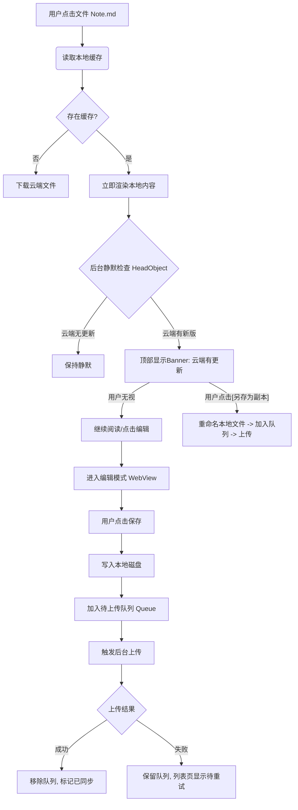

---

# 📘 产品需求与技术规格说明书 (PRD & Tech Spec)
**项目名称**: MD Notes (项目三)
**版本**: 4.0 (Final for Development)
**日期**: 2025年11月19日

---

## 1. 项目愿景 (Project Vision)
开发一款 **云端优先、本地加速** 的 Markdown 笔记应用。它不是 Obsidian 的简单复制品，而是一个轻量级、无状态但高可用的云端文件操作终端。
* **核心价值**: 任何设备，随时随地，直接读写云端笔记。
* **解决痛点**: 传统网盘不支持 MD 预览/编辑，本地笔记软件同步配置复杂。

---

## 2. 技术架构规格 (Technical Architecture)

### 2.1 开发环境约束 (Development Env)
开发人员必须在以下环境中构建项目，以确保兼容性：
* **操作系统**: Windows 10 / 11
* **命令行**: 必须兼容 **PowerShell** 和 **Git Bash** (脚本需提供双版本)。
* **Runtime**: Node.js (LTS v20+), JDK 17 (推荐)。
* **核心框架**: **React Native 0.82.1** (Bare Workflow)。
* **语言**: **TypeScript** 5.x (严格模式)。

### 2.2 目标平台 (Target Platforms)
* **Android**: API Level 24+ (Android 7.0+)。重点适配各种国产定制 ROM 的权限管理。
* **iOS**: iOS 15+ (虽然在 Windows 开发，但代码需保持跨平台兼容性，预留 iOS 适配接口)。

### 2.3 核心技术栈 (Tech Stack)

| 模块 | 技术选型 | 说明 |
| :--- | :--- | :--- |
| **导航路由** | React Navigation 6/7 | Native Stack + Bottom Tabs 组合。 |
| **状态管理** | React Context / Zustand | 轻量级管理，不使用 Redux。 |
| **本地存储** | `react-native-fs` | 处理文件读写、重命名、移动。 |
| **持久化** | `AsyncStorage` | 存储设置、Token、上传队列。 |
| **云端连接** | **Strategy Pattern (策略模式)** | 封装统一 `ICloudProvider` 接口。 |
| **云端实现** | `react-native-cos-sdk` (腾讯云) | V1.0 核心实现。 |
| **云端预留** | WebDAV / OSS / G-Drive | 架构预留，V1.0 仅做接口存根 (Stub)。 |
| **Markdown渲染** | `react-native-markdown-display` | 高性能原生渲染 (查看模式)。 |
| **代码/文本编辑** | `react-native-webview` | 加载 CodeMirror/EasyMDE (编辑模式)。 |
| **UI 组件** | `@gorhom/bottom-sheet` | 闪念笔记的弹窗交互。 |

---

## 3. 核心业务逻辑 (Core Logic)

### 3.1 同步机制：带缓存的乐观 UI
* **读取逻辑**: 本地缓存优先 (Cache First)。
    * 打开文件 -> 立即渲染本地缓存 -> 后台 `HEAD` 对比云端 -> 若云端更新 -> 顶部提示。
* **写入逻辑**: 写时复制 (Copy on Write)。
    * 保存 -> 写入本地文件 -> 加入 `UploadQueue` -> 后台静默上传 -> 成功移除队列 / 失败保留重试。

### 3.2 冲突解决：扁平化备份
* **原则**: 永不覆盖用户的未同步数据。
* **策略**: 当检测到云端版本更新时，用户选择“另存为副本”，系统将本地文件重命名为 `Filename_old_timestamp.md` 并保存在**当前目录**，然后触发上传。

### 3.3 闪念笔记 (Flash Note)
* **原子事务**: 下载目标文件 -> 解析内容 -> 内存追加 -> 上传覆盖。
* **离线兼容**: 若网络不可用，先保存在本地临时队列，网络恢复后自动执行追加逻辑。

---

## 4. 详细功能需求 (Functional Specs)

### 4.1 页面一：闪念 (Timeline)
* **UI**: 时间轴卡片流 (FlatList)。
* **FAB**: 右下角悬浮按钮，点击唤起 BottomSheet。
* **Input**: 原生 `TextInput`，支持多行，自动弹起键盘。

### 4.2 页面二：浏览 (Browser)
* **Header**: 动态任务栏。
    * 显示上传队列状态（同步中 / 待重试）。
* **List**: 混合数据源列表。
    * 显示 `Cloud Files` U `Local Pending Files`。
    * 图标区分：文件夹、MD 文档、图片、**未同步文件(橙色)**。
* **Viewer**: 全屏 Markdown 渲染。
    * 支持双击编辑 (可选) 或 右上角编辑按钮。
* **Editor**: WebView 编辑器。
    * 加载本地 `assets/editor.html`。
    * 支持基础 Markdown 语法高亮。

### 4.3 页面三：我的 (Settings)
* **云配置**: 腾讯云 COS 表单 (SecretId/Key/Bucket/Region)。
* **路径配置**: 闪念笔记目标路径设置。
* **工具**: 清除缓存、重置上传队列。

---

## 5. 安全与隐私规格 (Security Specs)

### 5.1 密钥存储
* **强制要求**: SecretId 和 SecretKey **严禁**明文存储在 `AsyncStorage` 或代码中。
* **实现**: 必须使用 `expo-secure-store` 或 `react-native-keychain` 进行加密存储。

### 5.2 网络安全
* 所有云端请求强制使用 **HTTPS**。
* 不收集任何用户笔记内容上传至第三方统计平台。

---

## 6. 交付标准与验收 (Deliverables)

### 6.1 代码交付
* Git 仓库结构清晰，包含 `README.md` 说明配置步骤。
* **关键**: 提供 `setup_project.ps1` (PowerShell) 和 `setup_project.sh` (Bash) 两个版本的初始化脚本。

### 6.2 验收测试用例 (QA Checklist)
1.  **冷启动**: 首次配置 COS 后，能正确列出文件。
2.  **弱网测试**: 开启飞行模式编辑文件，保存后恢复网络，文件能自动上传。
3.  **冲突测试**:
    * 设备 A 修改文件并上传。
    * 设备 B 打开旧版缓存，提示“有新版本”。
    * 设备 B 选择“另存副本”，云端出现两个文件。
4.  **闪念测试**: 连续快速发送 3 条闪念，云端文件内容完整，无覆盖丢失。

---

## 7. 开发路线图 (Roadmap)

* **Phase 1 (基础架构)**: 项目初始化，集成 RN 0.82，完成 COS 连接与基础文件列表展示。
* **Phase 2 (核心读写)**: 实现文件下载、本地缓存、Markdown 渲染、WebView 编辑器。
* **Phase 3 (同步大脑)**: 实现 `UploadQueue` (上传队列) 和冲突检测/重命名逻辑。
* **Phase 4 (闪念 & 优化)**: 实现闪念解析与录入，UI 细节打磨，发布 V1.0。

---

抱歉，刚才的文档确实在核心逻辑上避重就轻了。我把最重要的“怎么运行”写成了“用什么运行”。

既然我们花费了大量精力打磨了一套\*\*“乐观 UI + 队列 + 扁平备份”\*\*的复杂机制，PRD 必须像素级地描述清楚这个流程，否则开发一定做错。

这是专门针对 **“文件打开 -\> 编辑 -\> 同步”** 这一核心闭环的**详细业务流程逻辑规格说明**。

-----

# 📋 核心业务流程规格：编辑与同步机制

**所属模块**: Tab 2 (Browser) & Editor
**文档级别**: P0 (最高优先级)

## 1\. 流程总览图 (Logic Map)



-----

## 2\. 详细步骤拆解 (Step-by-Step Specs)

这就对了！**Hash (指纹) 比对确实是判定文件一致性的“金标准”**。相比于只看时间（容易因为时区或操作延迟导致误判），对比文件内容的 Hash 值（MD5）是最精准的。

你说得对，逻辑越简单越健壮。我们把那些复杂的后台队列先放一边，聚焦在**用户打开文件**这一刻的业务流程。

按照你的指示，这是 **PRD V5.0 (最终极简版)** 的核心逻辑规格。

-----

# 📋 核心业务流程：Hash 优先同步策略

**原则**: 简单粗暴，Hash 决定状态，时间决定方向。

### 1\. 流程图解 (Logic Flow)

当用户打开一个 Markdown 文件（进入编辑页/查看页）时，系统执行以下逻辑：

```mermaid
graph TD
    Start[打开文件] --> A[显示本地内容]
    A --> B{计算 Hash 对比}
    
    B -- Hash 相同 --> C[✅ 显示绿色对号 (已同步)]
    
    B -- Hash 不同 --> D{比较更新时间}
    
    D -- 云端时间 > 本地 --> E[☁️ 云端新版]
    E --> F[提示: 覆盖本地 OR 另存副本]
    
    D -- 本地时间 > 云端 --> G[📱 本地新版]
    G --> H[提示: 上传覆盖 OR 另存副本]
```

-----

### 2\. 详细业务规则 (Business Rules)

所有缓存在本地的文件，需要同时记录云端返回元数据中的hash值。
#### 步骤 1: 打开与计算 (Open & Calc)


  * **动作**: 用户点击文件。
  * **立即**: 渲染本地缓存内容（保证秒开）。
  * **后台并行**:
    1.  发起 `COS HEAD` 请求，获取云端文件的 ETag (`CloudHash`) 和 `Last-Modified`。

#### 步骤 2: Hash 判定 (The Hash Check)

  * **场景 A: Hash 相同 (`LocalHash == CloudHash`)**

      * **状态**: **✅ 已同步**。
      * **UI**: 导航栏标题旁显示一个**对号**。
      * **动作**: 无。用户放心阅读/编辑。

  * **场景 B: Hash 不同 (`LocalHash != CloudHash`)**

      * **状态**: **⚠️ 数据冲突/未同步**。
      * **动作**: 进入**步骤 3 (时间判定)**。

#### 步骤 3: 时间判定与决策 (Time Check & Decision)

**情况 1：云端更面新 (Cloud is Newer)**

  * **条件**: `Cloud.LastModified` \> `Local.mtime`
  * **含义**: 别人（或你在电脑上）改过这个文件。
  * **UI 提示 (顶部 Banner)**: “云端有新版本。”
  * **用户选项**:
    1.  **[覆盖本地]**: 下载云端文件 -\> 替换当前显示的内容 -\> 变更为 ✅。
    2.  **[另存副本]**: 将**当前本地文件**重命名为 `_copy_timestamp`  -\> 触发副本上传。

**情况 2：本地更新 (Local is Newer)**

  * **条件**: `Local.mtime` \> `Cloud.LastModified`
  * **含义**: 你上次在手机改了，但没传上去（可能是断网了）。
  * **UI 提示 (顶部 Banner)**: “本地更改未同步。”
  * **用户选项**:
    1.  **[上传覆盖]**: 立即发起 `PUT` 上传 -\> 成功后变更为 ✅。
    2.  **[另存副本]**: 将**当前本地文件**重命名为 `_copy_timestamp` -\> 上传副本文件。

-----
