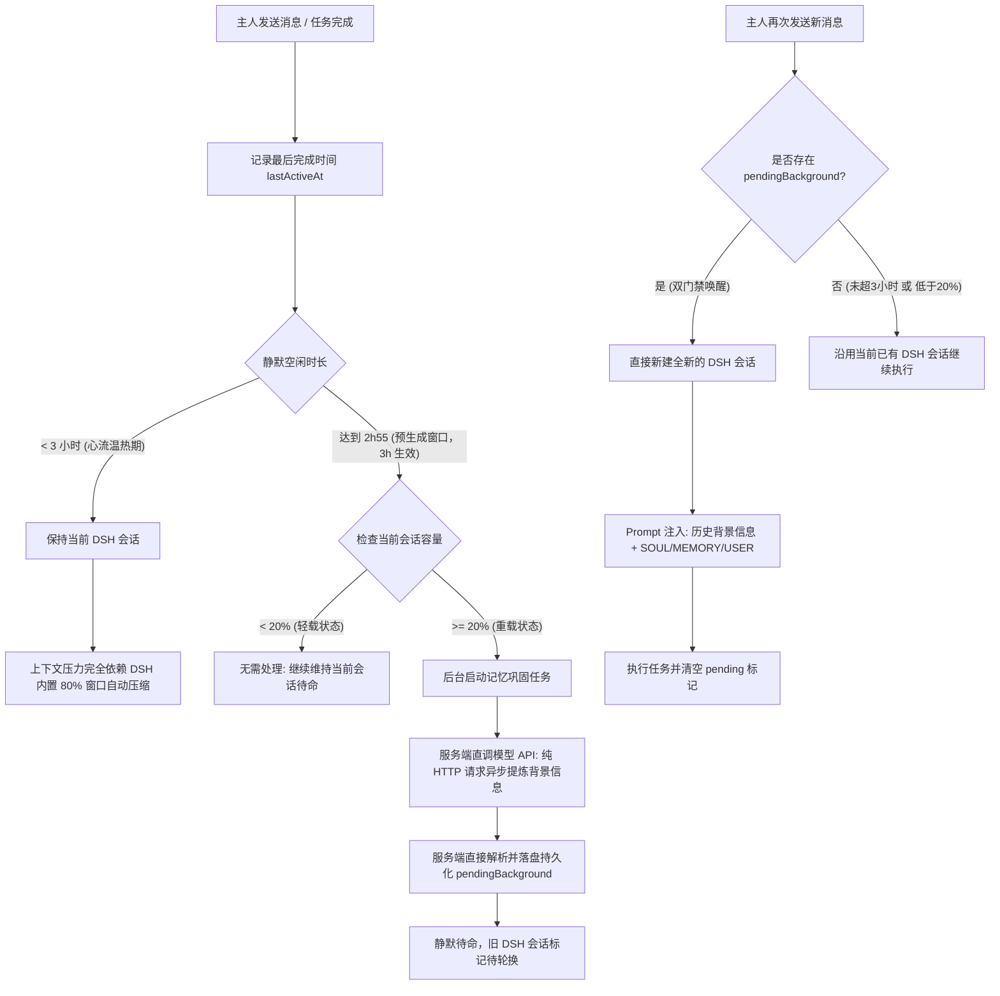

# 基于人脑记忆模型的会话轮换设计

## 1. 设计背景与核心理念

### 1.1 现状与真问题
在过去的实现中，绿天独立服务端试图在用户的永续主聊天与底层引擎（DSH）的会话之间建立 1:1 的终身永久绑定（单个会话一直 `--session-id` 续接到底）。

但前期对标研究（`docs/服务端/会话与上下文对标研究.md`）与实际工程实践表明，在底层用单一会话硬抗到底会面临无法逾越的技术与体验瓶颈：
1. **每轮恢复成本随时间持续恶化**：会话日志持续追加，每轮执行前重放反序列化历史帧的时间越来越长，成为系统唯一的无界耗时项；
2. **工具调用原始细节挤爆上下文**：终端输出、文件读取等海量工程噪音永久堆积在底层，加速触发模型强制压缩与信息退化；
3. **会话属性固化（Session Pinning）**：底层引擎出于安全假设，将创建瞬间的权限与模式永久写死在会话头部，老会话永远无法随环境升级而平滑演进。

### 1.2 人脑记忆模型（Cognitive Memory Model）
人类大脑从来不是靠“永不清空的单一记忆流”来与人交互的，而是分层协同的精妙网络：

```text
┌────────────────────────────────────────────────────────────────────────┐
│                        人脑记忆模型与系统架构映射                        │
├───────────────────────────────────┬────────────────────────────────────┤
│             人类认知机制          │             绿天系统实现           │
├───────────────────────────────────┼────────────────────────────────────┤
│ 1. 工作记忆 (Working Memory)       │ 底层 DSH 单次会话 (Runtime Session)│
│    - 短暂、高敏、注意力焦点       │    - 当期上下文、KV Cache、当轮工具│
│    - 持续交流中保持高度激活       │    - 3 小时内完全靠 DSH 内置压缩   │
├───────────────────────────────────┼────────────────────────────────────┤
│ 2. 睡眠期记忆巩固 (Consolidation) │ 后台静默期异步直发模型提炼背景     │
│    - 深度静默时海马体提炼故事概要 │    - 2h55 预生成 / 3h 生效，直调 API│
│    - 剥离具体神经放电，保留核心要点│    - 不走 DSH，零副作用，零等待    │
├───────────────────────────────────┼────────────────────────────────────┤
│ 3. 长期记忆检索 (Retrieval)        │ 新会话心智构建 (Cold Start Anchor) │
│    - 下次被唤醒时重新加载背景事实 │    - 达到双门禁才新建会话，轻载续用│
│    - 带着成熟心智与历史背景开聊   │    - 带着预制背景 + SOUL/USER/MEMORY│
└───────────────────────────────────┴────────────────────────────────────┘
```

**核心设计理念：**
- **UI 层是永续的长河**：主人在手机端面对的是唯一的个人助理窗口，聊天记录与交互气泡连贯无断层；
- **Harness 层是流动的消耗品**：底层的 DSH 会话是支撑当前心流的“工作记忆”，伴随心流结束而自然封存，伴随新的交互而清爽重启。

---

## 2. 产品形态演进：聊天与任务分开呈现（参考 Muse 模式）

当前绿天在主聊天中直接展示 `toolCalls` 卡片，使聊天流被大量工程细节打碎。参考 Meta Muse（青梧）的成熟产品形态，进行“聊天与任务分离”的架构升级：

```text
┌───────────────────────────────────────┬───────────────────────────────────────┐
│         主聊天视图 (Chat View)         │        任务活动流 (Task Stream)        │
├───────────────────────────────────────┼───────────────────────────────────────┤
│ • 纯净对话：仅展示主人与助手的自然语言│ • 独立展示：工具调用卡片、命令输出    │
│ • 极度轻量：剥离几千行终端输出污染    │ • 结构化沉淀：按时间线聚合任务卡片    │
│ • 上下文寿命极大延长，增长速率降为 1/5│ • 供回溯与审计，不干扰主对话心流      │
└───────────────────────────────────────┴───────────────────────────────────────┘
```

**对会话生命周期的重大收益：**
- **主聊天极度纯净**：日常咨询、写作与闲聊不再被工具调用输出污染，Token 消耗大幅放缓；
- **会话存活周期自然拉长**：由于排除了海量工具载荷，一个健康的单会话可以连续服务更长时间，而不会迅速触碰容量天花板。

---

## 3. 触发时机双重门禁：时间 × 容量复合判定

单纯的时间阈值（满 3 小时即切）存在严重的“轻量交互被误杀”缺陷：如果主人在这 3 小时里仅交流了两三句日常对话，整个会话占用的 Token 微乎其微，机械切会话纯属浪费算力并增加认知断层。

因此确立**“时间 × 容量”双重门禁（AND 逻辑）**：

```text
             ┌──────────────────────────────────────────────────┐
             │            触发后台背景提炼与新建会话             │
             │                      必须                        │
             │           【时间门禁】  AND  【容量门禁】          │
             └──────────────────────────────────────────────────┘
                                      │
                   ┌──────────────────┴──────────────────┐
                   ▼                                     ▼
           【时间门禁】: 超过 3 小时             【容量门禁】: 超过窗口 20%
        (最后活跃已满 3 小时深度静默)           (当前会话上下文占用 >= 20%)
```

### 3.1 复合判定矩阵

| 空闲时间 | 上下文占用情况 | 最终动作决策 | 设计理由与认知体验 |
| :--- | :--- | :---: | :--- |
| **< 3 小时** | 任意比例 | **保持原会话** | 心流温热期，上下文完全连贯，压力交给 DSH 内置 80% 自动压缩。 |
| **≥ 3 小时** | **< 20%（轻量）** | **继续沿用原会话** | **免切断**。对话极短，无恢复成本压力与膨胀负担，主人再次发问直接续用，零开销。 |
| **≥ 3 小时** | **≥ 20%（重度）** | **后台提炼，下次切新** | 双重门禁命中。服务端直接发模型生成《前序背景提要》，主人下次提问时直接新建清爽会话。 |

**预生成提前量（2h55 起跑）**：提炼不再等到满 3 小时才发起，而是在「门禁前 5 分钟」即 2h55 就进入后台预生成；3 小时只是**生效点**，不是**起跑点**。这样常见情况下主人回来时提要早已落盘，无需等待；若主人在 2h55~3h 之间提前回来，则直接丢弃这份预生成提要、继续用原会话，3 小时重新起算。提前量可由 `LVTIAN_CONSOLIDATION_LEAD_MS` 调整（默认 300000ms），且不超过门禁的一半。

---

## 4. 双阶段空闲流转与后台异步提炼机制

本设计的核心精髓在于：**将“记忆巩固”移至后台静默期提前完成，彻底杜绝用户提问时的等待延迟**。



### 4.1 阶段一：3 小时以内（温热期 / 心流保持）
- **策略**：**绝不主动新建会话**，保持现有 DSH 会话的绝对连贯；
- **模型上下文管理**：完全依赖 DSH 引擎内置的成熟机制（上下文窗口达到 80% 阈值时触发自动修剪大工具结果与摘要替换），系统不作任何多余打扰；
- **心流体验**：主人在此期间追问细节、连续调试，底层 KV Cache 保持命中，响应最快。

### 4.2 阶段二：满 2 小时 55 分起预生成（3h 门禁前 5 分钟），且容量 ≥ 20%
- **触发时机**：最后一次活跃经过 2 小时 55 分（即 3h 门禁前 5 分钟），且会话已消耗上下文达到或超过模型窗口的 20%（实际 100 万窗口下即占用达到 20 万 token）；提炼最长 30 秒超时、失败每分钟重试，5 分钟窗口足够 3~5 次尝试。真正的会话切换仍然只发生在满 3 小时之后；
- **核心铁律：直发模型，严禁走 DSH 引擎**：
  - **绝不启动 DSH 子进程或临时 DSH 会话**：DSH 是重量级 Agent 运行时（涉及插件沙箱、工具注册、zstd 日志等），用来做纯文本提炼是大炮打蚊子，还会产生垃圾会话文件与锁竞争；
  - **服务端自发自解（Direct HTTP Call）**：
    1. 从服务端自身的 `SessionManager` 中提取**全部会话历史**（不按条数、也不按 DSH 周期截断）；仅支持 100 万窗口的模型（小于 100 万不在支持范围）；单次预算 50 万字符，超出时按顺序分段提炼、再合并；
    2. 使用原生 `fetch` 直接向大模型平台（如 DeepSeek 官方兼容接口 `/v1/chat/completions`）发起一次轻量 HTTP POST 请求；
    3. 凭据直接复用环境变量 `DEEPSEEK_API_KEY`；
    4. 服务端直接解析 `choices[0].message.content`，抽取高度凝练的**《前序对话背景与核心结论》（历史背景信息）**；
    5. 将提炼结果以纯文本原子写入 `sessions/main/pending_background.txt`。

### 4.3 阶段三：用户再次发问（清爽唤醒时刻）
- **动作**：
  1. 服务端检测到 `pending_background.txt` 存在（已跨越双重门禁）；
  2. **直接抛弃旧 DSH 会话，创建全新的合法 DSH 会话**；
  3. **无缝拼接 Prompt（宏观心智提要 ＋ 微观关键原文）**：
     ```text
     [系统背景与主人长期档案]
     {SOUL.md} / {MEMORY.md} / {USER.md}

     [前序交流心智接力提要 (上次静默期归档)]
     {pendingBackground (300~500字)}

     [未竟事项与关键交互原文锚定 (至多5~8轮/最多1500~2000字)]
     {verbatimExcerpts}

     [主人当前提问与指令]
     {userPrompt}
     ```
  4. 新会话建立后删除 `pending_background.txt`，开始计算新一轮的计时与容量。提要是派生品，源对话仍完整保存在服务端会话历史里，下一次提炼直接读最近消息即可。
  5. **提前回来则丢弃**：若主人在 2h55~3h 之间发来消息，删掉预生成提要、继续沿用原会话，活跃时间照常刷新，3 小时重新起算；提要单独存在不构成轮换理由。
  6. **按消息到达时刻判定**：3 小时门禁以主人消息到达服务端的时刻计算，而不是引擎就绪时刻。否则 2h59:59 发出的消息可能因为建引擎多花两秒而被误判成「满 3 小时」，白白切断温热会话。
- **用户收益**：
  - **首字零额外延迟**：背景信息在主人离开 2h55 的预生成窗口就已写好，3 小时门禁一到即可直接使用；主人发问时**不需要等总结耗时**，直接秒回；
  - **兼顾宏观与微观指代**：宏观提要掌握大局，关键原文保证主人无论追问“你刚才说的第2条”还是特定措辞，助手都能精准理解；
  - **彻底告别底层恢复膨胀**：新会话没有过去几百个 zstd 帧的包袱，启动瞬间完成；
  - **天然具备最新环境与权限**：新会话直接在当前最新的系统环境中拉起，彻底规避 Session Pinning 问题。

---

## 5. 心智接力棒——背景提炼提示词工程设计

**不能做简单的“机械摘要”**。简单的摘要（如“用户问了A，助手答了B，随后探讨了C”）对新会话不仅无用，还会丢失人与人之间微妙的心流默契。

真正的背景压缩，是在制作一份**高密度的“心智接力棒（Mental Relay Baton）”**，如同高级参谋在将军睡醒时递上的一页晨报。

### 5.1 提炼维度的四重透镜
提炼提示词必须强制模型穿透四个维度，忽略其余一切工程杂质：

1. **【终态盘面与共识】（The Ground Truth & Consensus）**
   - 过滤掉过程中的一切争论、反复确认、临时试错；
   - 仅记录：上一场交流最终明确定下的**事实判断、技术路线或业务共识**是什么？
2. **【悬置意图与未竟事务】（The Hanging Threads / Next Actions）**
   - 心理学上的“蔡加尼克效应”：人脑对未完成事项的敏感度最高；
   - 提炼：主人停下来之前，最后提出的**开放式想法、未解的疑问、或明确留待下一步推进的事情**是什么？
3. **【主人新涌现的态度与规矩】（Emerged Preferences & Corrections）**
   - 在上一轮对话中，主人纠正了助手的什么误区？表现出了什么新的偏好或审美？定了什么新规矩？
   - 这一项极其重要，必须显式传递给新会话，**防止新会话换了壳子后重蹈覆辙，再次犯上一轮刚刚被主人纠正过的错误**。
4. **【活跃实体与关键上下文】（Active Entities & States）**
   - 当前正在推进的项目、代码分支、关键文件路径、正在讨论的人物或特定名词；
   - 仅保留最终有效的最新状态，杜绝历史冗余。

### 5.2 关键原文锚定机制（Verbatim Anchoring）
仅有宏观总结是不够的。在人类的真实对话中，主人非常容易使用指示代词（例如：“你刚才说的第三点，展开说说”或“就按我刚才的原话改”）。若无原文，模型会当场失明。

因此确立**“关键原文物理锚定规则”**：
1. **保留对象**：
   - 上一轮对话中最重要、对后续交流最有用的核心事项；
   - 尤其是**未竟事项、挂起待决议题、最有可能在后续对话中再次提及的具体方案讨论**；
2. **过滤排除**：
   - 已经明确写入长期记忆文件（`MEMORY.md`、`USER.md`）或行为准则（`AGENTS.md`）的规则与偏好，不再保留原文（长期文件已有，避免双重冗余）；
3. **动态自适应回溯策略（以字数设硬顶，以轮数保连贯）**：
   - **宏观提要**：维持在 **300 ~ 500 字**（战略全局、共识、未竟事务、主人态度）；
   - **微观原文轮数放宽**：支持回溯最近 **5 ~ 8 轮** 交互（纯聊天短句交流时，能完整覆盖多个问答来回）；
   - **字数刚性硬顶（水库截断）**：微观原文总字数封顶在 **最多 1500 ~ 2000 字** 以内，采用倒序自适应追加——
     - 若近期对话短促（如单轮仅数十个字），可完整包容 6~8 轮连续心流；
     - 若某一轮回复较长，则自动在达到字数上限时截断在最近 4~5 轮；
   - **总体开销控制**：宏微观合计严格控制在 **2000 ~ 2500 字以内**（约 1.5k Token），仅占窗口的 1%~2%，既解决了轮数过少截断短对话的问题，又牢牢守住新会话轻装上阵的底线。

### 5.3 严厉的反向约束（Negative Constraints）
提示词中必须设置明确的红线，杜绝机器八股文：
- ❌ **严禁流水账时间线**：禁止使用“首先……接着……随后……最后……”的时间流水账句式；
- ❌ **严禁空洞外交辞令**：禁止出现“双方进行了深入探讨并达成多项共识”这类毫无信息密度的套话；
- ❌ **严禁记录失败的执行噪音**：禁止记录调试过程中的报错堆栈、打错的命令、临时的探测步骤；
- ❌ **字数硬约束**：控制在 300~500 字以内，讲人话，密度第一。

### 5.4 提示词模板草案（System Prompt for Background Extraction）

```text
你是一位深谙主人心意的私人机要参谋。
主人与助手刚刚结束了一轮密集的深度交流与任务推进，现已进入数小时的静默休息。
请你为下一轮即将被唤醒的助手，撰写一份高度精炼的【心智接力备忘录】（300~500字）。

你的目标不是记录他们说了什么话，而是提炼出“下一轮接力工作必须知道的心智状态”。

请严格遵循以下结构输出，语言简洁直白、密度极高，严禁流水账与套话：

### 1. 核心共识与最终盘面
- [他们最终确立了哪些结论、方案或事实？彻底忽略中间探讨试错，只写最终确定状态]

### 2. 悬置事项与下一步
- [交流暂停时，主人悬而未决的问题是什么？或者下一步明确要继续做的事是什么？]

### 3. 主人新定规矩与态度倾向
- [主人在此轮中纠正了助手什么误区？表现出了什么强烈偏好或做事原则？必须牢记防止下轮再犯]

### 4. 关键实体与最新状态
- [涉及的核心文档/代码/路径/参数及其最新状态]
```

### 5.5 提示词外置存储原则（严禁大段硬编码进代码）
提示词属于高频演进与调优的业务资产，统一作为独立文档存放在 `server/prompts/context_consolidation.md` 中：
- **严禁硬编码进代码**：TypeScript 代码中只保留文件读取（`fs.readFile`）与内容占位替换，严禁在代码中写死大段提示词文本；
- **免编译敏捷调优**：未来在实际使用中调整提炼维度、修改结构格式、微调字数约束时，直接修改该 Markdown 提示词文件即可即时生效，无需重新编译、打包或改动核心代码。

### 5.6 效果对比示例

| 维度 | 机械简单摘要（反面教材） | 心智接力备忘录（本方案设计） |
| :--- | :--- | :--- |
| **盘面呈现** | 用户和助手讨论了服务器会话问题，助手解释了dsh权限机制，用户提出了修改意见。 | **核心共识**：确立底层 DSH 会话为可轮换消耗品；确立 3h 空闲 × 20% 窗口双重门禁；确立主聊天与任务分开呈现（参考 Muse 纯净风）。 |
| **心流承接** | 助手随后修改了文档并记录了待办。 | **悬置事项**：主人明确指出背景提炼提示词不能简单摘要，正在推敲高质量心智接力模板。 |
| **主人态度** | 用户对之前的沟通提出了批评。 | **主人倾向**：反感过度工程设计（不要假续命、不搞配置指纹）；强调心跳与定时任务未来必须彻底独立会话，绝不污染主聊天。 |

---

## 6. 架构边界与会话隔离原则

为了保证主聊天会话的纯粹性与记忆准确性，确立以下架构边界：

### 6.1 主聊天计时唯真人推进
当前主聊天的 3 小时空闲计时，**完全且唯一由主人的真实对话交互推进**：
- 主人发送聊天消息且助手完成本轮执行后，记录最新的 `lastActiveAt`；
- 移动端纯网络层断线重连（WebSocket 握手、序号对账）仅为连接保活，不涉及业务逻辑，不刷新主聊天的活跃时间。

### 6.2 独立会话隔离原则（心跳与定时任务独立化）
主聊天专属于主人与助理之间的亲密心流互动。未来若扩展引入**心跳巡检任务**或**后台定时任务**，确立以下铁律：
- **心跳任务必须使用单独会话**：心跳巡检拥有独立的 DSH 实例，跑完即焚或独立维护，绝不进入主聊天会话；
- **定时任务必须使用单独会话**：定时提醒、定时统计等自主行为在专属后台会话中执行，只向主聊天推送最终提醒卡片或结果，不将其思考与工具过程污染进主聊天；
- **作息互不干扰**：任何外部任务与自动化心跳，绝不影响主聊天自身的 3 小时作息判定，从架构根源上杜绝会话污染与假续命。

---

### 6.3 上下文新鲜度：记忆文件是请求期数据，不是进程期配置

`SOUL.md`、`MEMORY.md`、`USER.md` 会被主人在使用过程中持续修改。早期实现把它们与引擎进程绑定，只在 `startEngine` 时读取一次：引擎常驻期间记忆再改也不生效，只有进程重启才会刷新。这不是设计取舍，是实现把「每轮都要用的数据」错当成了「进程启动配置」。

修正后的口径：

1. **每轮重读**：`execute` 开跑前重新读取三份记忆文件并重建 prompt 前缀；内容有变化时记一条日志。三份文件合计只有几十 KB，读取开销远小于一次模型调用。
2. **AGENTS.md 另行处理**：工作区指令由 harness 的 `dsh-agent-instructions` 负责——首次请求加载，之后在成功的 `read/write/edit` 之后的下一次请求对账，恢复会话时也会刷新；它与记忆文件各自独立、互不依赖。
3. **不做进程级长缓存**：缓存只允许按内容指纹复用，不能以「引擎已启动」为理由冻结。进程环境变量里的副本仅作兼容兜底，真正生效的是每轮拼进 prompt 的前缀。

这样「文件才是记忆」才成立：改完文件，下一轮就生效，不必等新会话，也不必重启引擎。

## 7. UI 与产品视角的“零感知与绝对连续”

在这一整套机制下，产品经理所要求的“像人类记忆一样自然”在前端得到了完美的呈现：

1. **聊天界面长河永不断流**：
   - 手机端看到的永远是唯一的主聊天流；
   - 翻看 3 天前、1 周前的聊天记录，历史气泡与对话依然完好可读；
2. **交流感知如同熟人重逢**：
   - 当主人离开半天后重新发一句：“刚才那个事情怎么样了？”
   - 助理因为带着预先提炼好的背景提要，能够直接说出：“刚才我们排查到了 VPS 的端口配置，结论是……我们现在继续推进第 2 步吗？”
   - 主人完全不会意识到底层经历了一次脱胎换骨的“会话换新”，只会觉得助理既聪明又体贴，且回答极快。
3. **架构健壮性**：
   - 即使后台在直调模型提炼背景时遇到网络超时或 API 报错，服务端直接 catch 记录日志，主流程不中断：下次发问时若无背景提要，依然可以通过 `SOUL/MEMORY/USER` 正常启动新会话，主业务永不阻断。

---

## 8. 实施演进步骤

1. **第一阶段：活跃时间与容量双重门禁**：
   - 在 `SessionManager` 中维护 `lastActiveAt` 与当前会话估算 Token 占用（或自 DSH usage 事件提取的窗口占比）；
   - 后台轻量扫描器：仅当 `空闲 >= 3h` 且 `容量 >= 20%` 时触发后台提炼；
2. **第二阶段：服务端直发模型提炼服务（独立 HTTP 链路）**：
   - 编写轻量提炼函数：服务端从 `SessionManager` 提取全部会话历史（按提供方窗口设定单次字符预算，超长时分段提炼再合并），读取外置提示词文件 `server/prompts/context_consolidation.md`，原生 `fetch` 直调大模型 API，解析出 300~500 字《前序交流背景提要》；
   - 落盘保存到 `sessions/main/pending_background.txt`，完全不触碰 DSH 运行时；
3. **第三阶段：唤醒即换新会话并注入背景**：
   - 下次执行时，重置底层 `dshSessionId` 为空，将提要拼入 Prompt 前置；
4. **第四阶段：移动端主聊天与任务流界面解耦（Muse 模式）**：
   - 主聊天界面移除内联工具活动卡片，保持极致纯净对话；
   - 新增独立的任务与活动流视图（参考青梧），工具活动集中沉淀展示。
