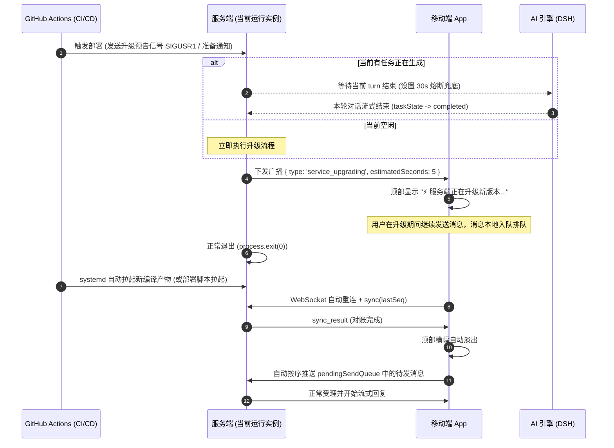

# 服务端优雅升级与自动部署设计

## 1. 模块定位与设计目标

绿天（Lvtian）独立服务端（`server/`）作为用户的个人 AI 助理中枢，承载全天候 WebSocket 长连接与底层智能体（ACP 驱动的 DSH 引擎）交互。

### 1.1 背景与对标
传统服务的硬重启（直接终止进程并重新拉起）会导致移动端突发断连、流式打字腰斩或执行中的命令被强行掐断，迫使开发团队只能在低峰期人工操作。
对标 Muse 等现代个人助理应用的工业级实践，绿天需要实现**主分支合并代码后随时自动部署**，并通过**“执行避让 + 升级感知 + 离线乐观入队”**三重机制，确保升级期间用户的心流完全不被打断。

### 1.2 核心目标
1. **随时随地自动部署（Continuous Delivery）**：主分支合并服务端代码时，GitHub Actions 自动化流水线自动交付到生产服务器，免去人工登录与操作。
2. **执行避让（Graceful Drain）**：部署触发时，不直接暴力杀死进程；若大模型正在打字输出或执行工具，等当前这一轮对话完成后再退出。
3. **升级主动感知（Proactive Notification）**：退出前主动向移动端广播升级事件，客户端明确告知用户“系统正在升级更新”，消除断网或崩溃的误解。
4. **用户输入零阻碍（Optimistic UI & Zero-Lock）**：在升级与重连的数秒窗口期内，**输入框绝不冻结**；用户可正常输入和发送，消息在本地排队并在连上后自动静默推送到服务端。

---

## 2. 产品交互规范与铁律（产品经理共识）

本章为前端与交互实现的核心约束，后续任何 AI 或工程师开发时均须严格遵守：

| 交互场景 | 规范要求与铁律 | 严禁行为 |
|---------|---------------|---------|
| **输入框状态** | **绝不冻结、绝不置灰、不弹全屏遮罩**。升级期间输入框完全可交互，键盘正常唤起，发送按钮正常可用。 | 严禁禁用输入框或给界面加阻断交互的加载层。 |
| **发送行为** | **本地乐观上屏（Optimistic UI）**。用户点击发送后，消息立即进入聊天气泡列表，右上角附带微小的轻量状态图标（如等待发送）。消息自动进入移动端未发队列（`pendingSendQueue`）。 | 严禁提示“网络未连接，发送失败”要求用户重试。 |
| **顶部状态横幅** | 收到服务端升级广播后，仅在聊天页顶部状态栏以温和轻量条呈现：<br>`⚡ 服务端正在升级新版本，稍候数秒自动恢复` | 严禁使用红色警报色或生硬的错误弹窗。 |
| **升级完成后恢复** | 服务拉起、长连接自动重连并完成对账后，移动端**自动静默补发**待发队列中的消息；顶部升级横幅自动淡出消失。AI 助理无缝进入思考并开始流式回答。 | 严禁要求用户手动点击重新发送。 |

---

## 3. 通信协议扩展

在 `server/src/protocol.ts` 与移动端协议定义中扩展下行报文：

### 3.1 下行升级通知报文 (`ServerMessage`)
```typescript
/** 服务端即将升级通知 */
export interface ServiceUpgradingMessage {
  type: 'service_upgrading';
  /** 预计重启恢复所需秒数（通常为 3~5 秒） */
  estimatedSeconds: number;
  /** 即将升级的目标版本号或提交简写 */
  targetVersion?: string;
  /** 提示文案（可选，客户端优先使用本地国际化） */
  reason?: string;
}
```

### 3.2 生命周期时序图



---

## 4. 服务端优雅退出实现（Graceful Drain）

### 4.1 触发与信号处理
在 `server/src/index.ts` 中挂载部署信号监听：
- 部署脚本在构建新产物后，向老进程发送系统信号 `SIGUSR1`（或执行 `npm run upgrade-notify`）。
- 服务端进入 `isDraining = true` 状态，拒绝新的高开销后台长期任务，但保证当前长连接正常通信。

### 4.2 避让等待逻辑
```text
if (sessionManager.hasActiveProcessing()) {
    等待 activeTurnFinishedPromise 或 30秒超时熔断;
}
向所有在线 WebSocket 客户端广播 service_upgrading;
等待 500ms 确保网络缓冲区刷出;
关闭所有连接与监听端口;
进程 exit(0);
```

### 4.3 故障熔断保护
若超过 30 秒当前任务仍未结束（例如工具执行死锁），触发超时保护，强制下发升级广播并退出，由 systemd 自动拉起，防止部署流水线无限挂起。

---

## 5. 移动端配合实现（离线队列与升级感知）

### 5.1 状态管理扩展 (`src/store/useAssistantStore.ts`)
- 新增 `isServerUpgrading: boolean`（默认为 false）。
- 新增 `pendingSendQueue: Array<{ sessionId: string, messageId: string, content: string }>`。

### 5.2 客户端协议监听 (`src/services/AssistantClient.ts`)
1. 收到 `service_upgrading`：
   - 将 `isServerUpgrading` 置为 `true`；
   - 调整重连策略：缩短前 3 次重试间隔（如 1 秒一次快速重连），以便服务端一旦就绪立即连上。
2. 收到 `sync_result`（重连成功并对账完成）：
   - 将 `isServerUpgrading` 置为 `false`；
   - 检查 `pendingSendQueue`，若有积压消息，按序依次调用 `sendMessage` 发送并移出队列。

### 5.3 界面渲染 (`src/screens/ChatScreen.tsx`)
1. 顶部状态横幅：
   - 仅在 `isServerUpgrading === true` 时展示黄色/蓝色温和横幅：`⚡ 服务端正在升级新版本，稍候数秒自动恢复`。
2. 输入框交互：
   - **绝不被 `isServerUpgrading` 属性禁用**。
   - 用户发送消息时，若当前连接未处于就绪态或处于升级中，消息先添加到本地聊天记录（附带 `isPending: true` 样式），并入队到 `pendingSendQueue`。

---

## 6. GitHub Actions 自动部署流水线

### 6.1 流水线设计 (`.github/workflows/server-deploy.yml`)
- **触发条件**：
  - `push` 到 `main` 分支；
  - 改动路径过滤：仅当包含 `server/**` 或当前工作流自身时触发；
  - 支持 `workflow_dispatch` 手动触发。
- **安全凭据**：
  - 依赖 GitHub Secrets：`SERVER_HOST`（公网 IP）、`SERVER_PORT`（SSH 端口）、`SERVER_USER`（ubuntu）、`SERVER_SSH_KEY`（专用部署私钥）。

### 6.2 部署步骤
1. **Runner 预备**：检出代码并设置 SSH 密钥通道；
2. **服务器端同步**：
   - 进入部署目录（标准路径为 `/home/<user>/code/lvtian`，兼容 `/home/<user>/lvtian-server`）；
   - 执行 `git pull origin main`；
   - 检查 `server/package.json` 与 lockfile 变动，必要时执行安全的增量安装（避免清空运行中 node_modules）；
   - 执行 `npm run build` 生成最新 `dist/`；
3. **平滑优雅重启**：
   - 执行优雅停机脚本：向正在运行的服务进程发送升级信号；
   - 老服务广播通知并优雅退出；
   - systemd 的 `Restart=always` 自动将新编译版本秒级拉起；
4. **健康检查（Health Check）**：
   - 轮询 `http://127.0.0.1:1999/health`，验证返回 200 与最新状态；
   - 验证通过后流水线标记为成功；若 60 秒内未就绪，输出服务日志并报错。

---

## 7. 演进路线与分步计划

1. **第一阶段：协议与优雅退出服务**
   - 在 `protocol.ts` 补充 `service_upgrading` 类型；
   - 在 `index.ts` 与 `server.ts` 实现避让与广播退出逻辑，配合测试用例验证。
2. **第二阶段：移动端离线队列与升级横幅**
   - 在 `AssistantClient` 与 `useAssistantStore` 实现离线排队与自动重发；
   - 在 `ChatScreen` 添加顶部温和提示横幅并验证输入框畅通无阻。
3. **第三阶段：GitHub Actions 部署流水线打通**
   - 配置服务器专属部署密钥并注入 GitHub Secrets；
   - 创建 `.github/workflows/server-deploy.yml`，端到端验证主分支合并后的全自动交付。
